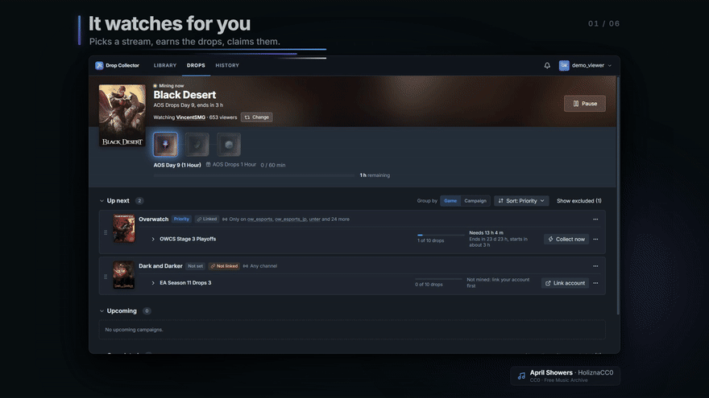
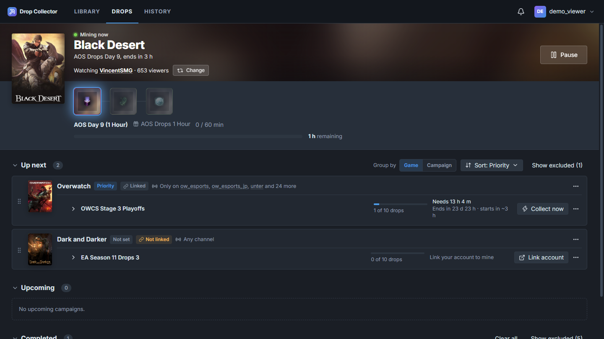
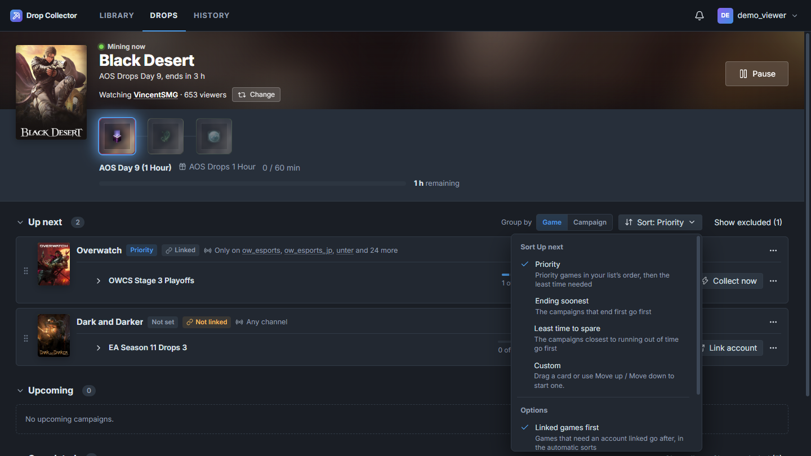
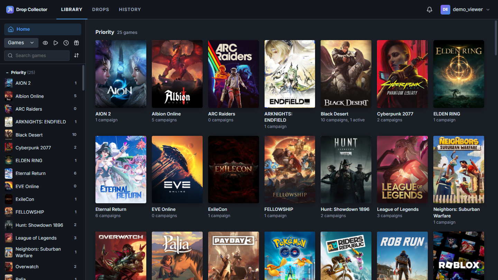
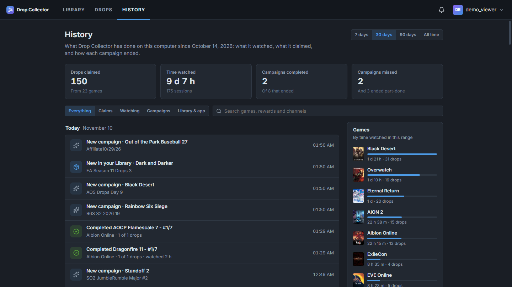
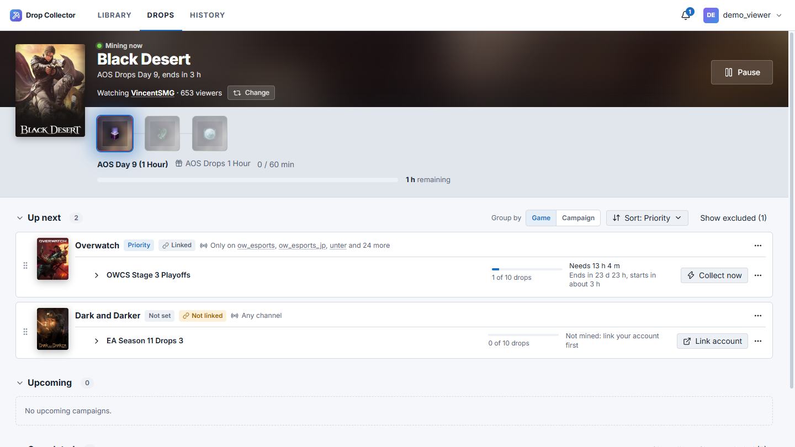

# Twitch Drop Collector

**Your Twitch drops, collected while you get on with your day.**

A free desktop app that watches the right streams in the background, earns the drops you care about and claims them for you. You decide what comes first, and you can see everything it did.

[**Download**](#download) · [Website](https://kyleshrader.github.io/twitch-drop-collector/) · [Watch the trailer](https://kyleshrader.github.io/twitch-drop-collector/#trailer) · [Report a problem](https://github.com/kyleshrader/twitch-drop-collector/issues)

## Why use it

Twitch drops reward you for watching, but earning them means keeping the right stream open for hours and remembering to claim each reward. Twitch Drop Collector does that for you, quietly, without a browser tab: no video plays, so it uses almost nothing.

## Features

### It watches for you

It finds a live channel with drops enabled for your top campaign, watches it in the background and claims each reward the moment it unlocks. You see the game, the channel, the drop and the time left, and you can pick another channel any time. When you're offline or the computer sleeps, it pauses itself.

### Your queue, your order

Every campaign it can earn sits in one queue, **Up next**. Sort it by priority, by what ends soonest or by what's most at risk, or drag cards into your own order. "Collect now" jumps one to the front. Each card says which channels count, and the app warns you when a campaign won't finish in time.

### Every game in one library

A library of every game with drops, with box art, plus any game you want to rank or skip, even ones with no drops yet. Put games on **Priority** or **Excluded**, see which need your account linked, and open any game to see its campaigns and every drop.

### See everything it did

**History** is a timeline of what it watched, what it claimed, which campaigns turned up and how each one ended. It has totals for the week, month or all time, and you can filter by any game, reward or channel. It stays on your computer.

### And more

- **Ready when Twitch changes:** every response from Twitch is checked. If something changes, you get one notification and a ready-to-send bug report, with anything personal removed.
- **Safe sign-in:** sign in on Twitch's own page, or with a code at twitch.tv/activate. The app never sees your password, and it stores your session encrypted with your system's keychain.
- **Respects your accounts:** it never claims for a game account you haven't linked, and it shows you where to link one.
- **Lives in the tray:** close the window and it keeps going. It can start with your computer.
- **Dark, light or system theme**, full keyboard support and automatic updates.
- **Proxy support** (HTTP or SOCKS) for networks that need one.

## Download

The latest version is **0.1.0-beta.2** (beta). [What's new](https://github.com/kyleshrader/twitch-drop-collector/releases/tag/v0.1.0-beta.2)

| Platform                               | Download                                                                                                                                              |                                                                   |
| -------------------------------------- | ----------------------------------------------------------------------------------------------------------------------------------------------------- | ----------------------------------------------------------------- |
| **Windows** 10 and 11, 64-bit          | [Installer (.exe)](https://github.com/kyleshrader/twitch-drop-collector/releases/download/v0.1.0-beta.2/twitch-drop-collector-0.1.0-beta.2-setup.exe) | Updates itself                                                    |
| **macOS**, Apple Silicon (M1 or later) | [Disk image (.dmg)](https://github.com/kyleshrader/twitch-drop-collector/releases/download/v0.1.0-beta.2/twitch-drop-collector-0.1.0-beta.2.dmg)      | Drag to Applications                                              |
| **Linux** x64, any distribution        | [AppImage](https://github.com/kyleshrader/twitch-drop-collector/releases/download/v0.1.0-beta.2/twitch-drop-collector-0.1.0-beta.2.AppImage)          | Make it executable and run it; updates itself                     |
| **Debian and Ubuntu** x64              | [Package (.deb)](https://github.com/kyleshrader/twitch-drop-collector/releases/download/v0.1.0-beta.2/twitch-drop-collector_0.1.0-beta.2_amd64.deb)   | `sudo apt install ./twitch-drop-collector_0.1.0-beta.2_amd64.deb` |

Older versions are on the [releases page](https://github.com/kyleshrader/twitch-drop-collector/releases), and the [website](https://kyleshrader.github.io/twitch-drop-collector/#download) picks the right file for your system.

> The beta isn't code-signed yet. On Windows, if SmartScreen says "Windows protected your PC", choose **More info**, then **Run anyway**. On macOS, the first time, right-click the app in Applications and choose **Open**. An unsigned Mac app can't update itself, so download new versions from here.

## Get started

1. **Download** the installer for your system from the table above.
2. **Sign in with Twitch.** Link your game accounts on Twitch as usual.
3. **Pick your games** (Priority, Not set or Excluded) and let it run. Check History whenever you're curious.

The app is in beta. If something doesn't look right, please [open an issue](https://github.com/kyleshrader/twitch-drop-collector/issues): the Twitch API page in the app can fill one in for you.

## Questions

**Does it need a browser or Twitch open?** No. It talks to Twitch directly and counts watch time without playing video. Close the window and it keeps going in the tray.

**What does it connect to?** Twitch, and GitHub to check for updates. Nothing else, and your history never leaves your computer.

**Is it affiliated with Twitch?** No. It's an independent, open source project, not affiliated with or endorsed by Twitch.

The screenshots and trailer use the maintainer's own drop history, with the account replaced by a demo one. Trailer music: [April Showers](https://freemusicarchive.org/music/holiznacc0/spring-at-last-lofi-tape/april-showers/) by HoliznaCC0 (CC0, from Free Music Archive).

## For developers

Twitch Drop Collector is an Electron, React and TypeScript app in a Yarn monorepo, with unit, Electron and end-to-end tests. To build it, run the checks or contribute, see the **[developer guide](docs/DEVELOPMENT.md)**. Design and decision records are in [docs/](docs/).
